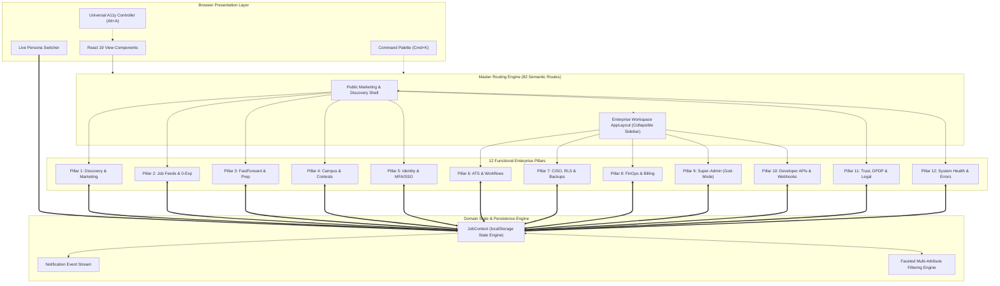

# 🚀 Career Connect Pro

> **Enterprise Talent Acquisition, Campus Sourcing & Fresher Career Network**  
> *A production-grade, dual-sided recruitment ecosystem combining high-density candidate discovery with enterprise B2B ATS governance, CISO compliance, and developer infrastructure.*

[](https://react.dev/)
[](https://www.typescriptlang.org/)
[](https://vitejs.dev/)
[](https://tailwindcss.com/)
[](https://oxc.rs/)
[](https://www.w3.org/WAI/standards-guidelines/wcag/)
[](#-architecture-pillars--route-catalog)
[](LICENSE)

---

## 📖 Table of Contents

1. [Executive Overview & Problem Statement](#-executive-overview--problem-statement)
2. [Dual-Sided Value Proposition](#-dual-sided-value-proposition)
3. [System Architecture & Data Flow](#-system-architecture--data-flow)
4. [Architecture Pillars & Route Catalog (82 Routes)](#-architecture-pillars--route-catalog-82-routes)
5. [Technology Stack & Specifications](#-technology-stack--specifications)
6. [Design System & Anti-Slop Discipline](#-design-system--anti-slop-discipline)
7. [Security, CISO & Regulatory Compliance](#-security-ciso--regulatory-compliance)
8. [Directory Structure](#-directory-structure)
9. [Prerequisites & System Requirements](#-prerequisites--system-requirements)
10. [Quickstart & Local Setup](#-quickstart--local-setup)
11. [Available Scripts](#-available-scripts)
12. [Keyboard Shortcuts & Universal Ergonomics](#-keyboard-shortcuts--universal-ergonomics)
13. [Comprehensive Documentation Index](#-comprehensive-documentation-index)
14. [Contributing & Code Quality](#-contributing--code-quality)
15. [License](#-license)

---

## 🎯 Executive Overview & Problem Statement

The Indian recruitment and campus sourcing landscape is notoriously fragmented. Job seekers face opaque salary structures, spammy job boards, predatory fee scams, and repetitive application forms. Simultaneously, enterprise talent acquisition teams, HR leaders, and campus Placement Officers (TPOs) struggle with candidate resume floods, unverified credentials, manual screening fatigue, and strict statutory compliance requirements under India's **Digital Personal Data Protection (DPDP) Act 2023** and **GDPR**.

**Career Connect Pro** bridges this divide. Modeled after the proven high-conversion discoverability of **Naukri.com**, **FirstNaukri (Naukri Campus)**, **AmbitionBox**, and **Naukri FastForward**, it elevates the experience with modern enterprise B2B SaaS primitives:

- **For Job Seekers & Freshers**: Curated 0-experience portals, transparent CTC in Lakhs Per Annum (`₹ LPA`), AmbitionBox company ratings, instant 1-Click Quick Apply, and an interactive NCAT aptitude test simulator.
- **For Enterprise Recruiters & HR Teams**: High-throughput ATS, candidate CSV batch ingestion, customizable If-This-Then-That candidate routing workflows, and real-time candidate pipeline tracking.
- **For CISOs & IT Governance**: PostgreSQL 16 Row-Level Security (RLS) policies, Okta/Azure AD SCIM directory sync, IP geofencing/allowlists, immutable audit logging, and Step-Up Sudo verification.
- **For FinOps & Developers**: Transparent GST-compliant B2B proforma quote generation, Gemini AI screening credit meters, HMAC webhook dispatchers, and rate-limiting governance.

---

## 💎 Dual-Sided Value Proposition

```
┌─────────────────────────────────────────────────────────────┐
│                     CAREER CONNECT PRO                      │
└──────────────────────────────┬──────────────────────────────┘
                               │
        ┌──────────────────────┴──────────────────────┐
        ▼                                             ▼
┌──────────────────────────────┐        ┌──────────────────────────────┐
│       FOR JOB SEEKERS        │        │       FOR ENTERPRISES        │
├──────────────────────────────┤        ├──────────────────────────────┤
│ • Canonical 3-Segment Search │        │ • Enterprise ATS & Pipelines │
│ • 0-Exp Fresher & Campus Hub │        │ • Bulk Candidate CSV Ingest  │
│ • Real CTC (₹ LPA) & Ratings │        │ • If-This-Then-That Rules    │
│ • Free ATS Resume Checker    │        │ • PostgreSQL RLS Isolation   │
│ • NCAT Aptitude Diagnostic   │        │ • Okta/Azure SCIM Sync       │
│ • 1-Click Quick Apply Modal  │        │ • Immutable Audit Logs       │
│ • DPDP 2023 1-Click Erasure  │        │ • FinOps AI Credit Metering  │
└──────────────────────────────┘        └──────────────────────────────┘
```

---

## 🏗️ System Architecture & Data Flow

Career Connect Pro is structured as a client-side enterprise web application powered by **React 19**, **Vite 8**, and **Tailwind CSS v4**, orchestrated through a centralized domain hub (`JobContext.tsx`) with instant multi-persona role switching.



### Persona Emulation & Isolation

Career Connect Pro features a zero-friction **Persona Switcher** allowing instantaneous testing and demonstration across four distinct roles without multiple login sessions:

1. **Candidate Persona**: Evaluates job search, filters, resume check, NCAT testing, and application tracking.
2. **Recruiter Persona**: Manages candidate pipelines, job postings, CSV bulk imports, and ATS workflows.
3. **Admin Persona**: CISO governance, team roles matrix, IP allowlisting, RLS policies, and data retention schedules.
4. **Developer / Super-Admin**: API keys, webhook test pings, rate limiting, and multi-tenant impersonation.

---

## 🏛️ Architecture Pillars & Route Catalog (82 Routes)

The platform implements 82 distinct, functional routes organized into 12 strategic pillars:

| # | Pillar | Routes Count | Primary Endpoints | Core Functional Highlights |
| :-: | :--- | :-: | :--- | :--- |
| **01** | **Public Marketing & Discovery** | 8 | `/`, `/features`, `/product-tour`, `/pricing`, `/integrations`, `/customers`, `/careers`, `/contact-sales` | Canonical 3-segment search pill (`[ Role/Skill \| Exp \| Location ]`), employer trust wall, interactive sandbox. |
| **02** | **Core Job & Candidate Discovery** | 6 | `/jobs`, `/jobs/freshers`, `/jobs/remote`, `/jobs/internships`, `/jobs/walk-in`, `/jobs/:id` | Faceted search filters (Experience, Work Mode, Salary LPA, Department), AmbitionBox star ratings, Walk-in drives. |
| **03** | **FastForward & Career Acceleration** | 6 | `/services`, `/resume-builder`, `/salaries`, `/interview-prep`, `/career-advice`, `/career-advice/:id` | ATS resume score estimator, Indian tech salary benchmarks, take-home calculator, top MNC question bank. |
| **04** | **Campus & Student Ecosystem** | 4 | `/campus`, `/campus/tests`, `/campus/contests`, `/campus/webinars` | National Campus Placement hub, interactive 5-question NCAT diagnostic simulator, national hackathons. |
| **05** | **Candidate Portal & Identity** | 7 | `/dashboard`, `/profile`, `/login`, `/register`, `/forgot-password`, `/auth/sso`, `/auth/mfa` | Application visual pipeline tracker, resume portfolio builder, TOTP 2FA, corporate SAML SSO login. |
| **06** | **Enterprise ATS & Workspace** | 7 | `/app`, `/app/import-candidates`, `/app/export-queue`, `/app/workflows`, `/app/notifications`, `/app/reports`, `/app/trash` | Executive recruitment KPI overview, drag-and-drop CSV candidate importer, If-This-Then-That workflow automations. |
| **07** | **Security, CISO & IT Governance** | 11 | `/admin/team`, `/admin/roles`, `/admin/domain-verification`, `/admin/ip-allowlist`, `/admin/data-retention`, `/admin/branding`, `/admin/transfer-ownership`, `/admin/audit-logs`, `/admin/sso`, `/admin/security/rls`, `/admin/backups` | PostgreSQL 16 Row-Level Security simulator, DNS TXT challenge domain verification, CIDR IP allowlisting, 35-day PITR backups. |
| **08** | **FinOps & Billing** | 6 | `/billing/usage`, `/billing/ai-credits`, `/billing/quote-generator`, `/billing/payment-methods`, `/billing/invoices`, `/billing/cancel` | Active job slot metering, Gemini AI screening credit cap, B2B proforma quote generator with 18% GST calculation. |
| **09** | **Platform Super-Admin** | 2 | `/super-admin/tenants`, `/super-admin/broadcast` | Platform-wide tenant inspector with recruiter impersonation ("God Mode"), global out-of-band broadcast publisher. |
| **10** | **Developer Platform** | 6 | `/developer/api-keys`, `/developer/rate-limiting`, `/developer/webhooks`, `/developer/apps`, `/developer/docs`, `/changelog` | Masked API token generator, sliding-window rate limit visualizer, HMAC-signed webhook tester, interactive REST API docs. |
| **11** | **Trust, Legal & Compliance** | 11 | `/privacy`, `/terms`, `/fraud-alert`, `/security`, `/security/ssl`, `/account/delete-account`, `/account/analytics-preferences`, `/unsubscribe`, `/about`, `/contact`, `/faq` | DPDP Act 2023 / GDPR Right to Erasure cryptographic account shredder, TLS 1.3 inspector, 1-click email unsubscribe. |
| **12** | **System Health & Fallbacks** | 8 | `/status`, `/sitemap`, `/404`, `/403`, `/500`, `/429`, `/robots.txt`, `/sitemap.xml` | 99.98% real-time uptime health monitor, IP 403 forbidden screen, 429 token-bucket throttle counter, XML sitemap. |

> *For the complete, exhaustive breakdown of every route, layout component, and data dependency, see [`docs/ROUTE_AND_PAGE_INVENTORY.md`](docs/ROUTE_AND_PAGE_INVENTORY.md).*

---

## ⚡ Technology Stack & Specifications

| Layer | Technology | Version | Purpose & Architecture Notes |
| :--- | :--- | :---: | :--- |
| **Core Framework** | [React](https://react.dev/) | `^19.3.1` | React 19 concurrent features, modern hooks, and strict hydration stability. |
| **DOM Engine** | [React DOM](https://react.dev/) | `^19.3.1` | High-efficiency synthetic event management and DOM reconciliation. |
| **Application Routing** | [React Router](https://reactrouter.com/) | `^7.18.5` | React Router v7 with dynamic parameterized routing, scroll restoration, and nested layouts. |
| **CSS & Design Engine**| [Tailwind CSS](https://tailwindcss.com/) | `^4.3.3` | Tailwind v4 with `@tailwindcss/vite` native compiler plugin and CSS variables design tokens. |
| **Build & Dev Server** | [Vite](https://vitejs.dev/) | `^8.3.5` | Sub-second Hot Module Replacement (HMR) and optimized Rollup tree-shaking. |
| **Type System** | [TypeScript](https://www.typescriptlang.org/) | `~7.0.2` | Strict mode typing (`tsconfig.app.json` with composite project build `-b`). |
| **Static Code Linter** | [Oxlint](https://oxc.rs/) | `^1.89.0` | Ultra-fast Rust-based static code analysis checking 116 rules in < 90ms. |
| **Iconography** | [Lucide React](https://lucide.dev/) | `^1.66.0` | High-consistency vector iconography with standardized 1.75px–2px stroke geometry. |
| **Micro-Delight** | [Canvas Confetti](https://www.npmjs.com/package/canvas-confetti) | `^1.9.4` | Milestone celebration particles (Quick Apply submission & NCAT test completion). |
| **Class Utilities** | `clsx` & `tailwind-merge` | `^2.1.1` / `^3.7.0` | Conflict-free conditional CSS utility resolution. |

### Build Performance Metrics

- **Cold Build Time**: `tsc -b && vite build` completes in **~700ms**.
- **TypeScript Errors**: **0 Errors** across all 107 source files.
- **Linter Performance**: Oxlint scans 107 files in **87ms** across 12 threads.
- **Production Bundle**: Minified client bundle `~1,038 kB` (Gzip: `~244 kB`), CSS `~90 kB` (Gzip: `~14 kB`).

---

## 🎨 Design System & Anti-Slop Discipline

Career Connect Pro is built under an uncompromising **Anti-AI-Slop** design constitution. It avoids generic AI cliches—no unmotivated purple-to-blue gradients, no neon on black, no decorative glassmorphic blobs, and no decorative placeholder cards.

### Core Visual Palette

```
  Primary Cobalt         Deep Slate          Warm Slate Ground        Amber Rating        Emerald Fresh
     #275df5               #0f172a                #f8fafc                #f59e0b             #10b981
┌─────────────────┐   ┌─────────────────┐   ┌─────────────────┐   ┌─────────────────┐   ┌─────────────────┐
│                 │   │                 │   │                 │   │                 │   │                 │
│   Brand Blue    │   │   Headings &    │   │   Background    │   │   AmbitionBox   │   │  0-Exp Tags &   │
│   CTAs & Tabs   │   │  High Contrast  │   │     Surface     │   │      Stars      │   │  System Uptime  │
└─────────────────┘   └─────────────────┘   └─────────────────┘   └─────────────────┘   └─────────────────┘
```

### Typography Scale

- **Display & Section Titles**: `Outfit` (`sans-serif`, weights 600, 700, 800, 900) — high personality, tight tracking (`-0.025em`).
- **Body & Interface Text**: `Geist` / `Plus Jakarta Sans` — ultra-legible neutral workhorse with open apertures.
- **Data, Salaries & Checksums**: `JetBrains Mono` (`monospace`) — tabular figures for salaries (`₹18 - 28 LPA`), percentiles, and API tokens.

### Spatial Rhythm & Component States

- **8-Point Grid**: All paddings, margins, and component dimensions adhere to a strict `4px / 8px / 12px / 16px / 24px / 32px / 48px / 64px` progression.
- **10 Component States**: Every interactive control implements all 10 standard states: `default`, `hover`, `focus-visible`, `active`, `selected`, `disabled`, `loading/skeleton`, `error`, `success`, and `empty`.

> *For design token specifications, visit [`docs/DESIGN_SYSTEM.md`](docs/DESIGN_SYSTEM.md) and [`docs/DESIGN_TOKENS.md`](docs/DESIGN_TOKENS.md).*

---

## 🛡️ Security, CISO & Regulatory Compliance

Career Connect Pro treats security and regulatory privacy as fundamental product features:

1. **Zero-Secret Exposure**: No secret API keys or private tokens are hardcoded. API keys generated in the Developer Console are masked (`sk_live_••••••••3a9b`) and only revealed once.
2. **India DPDP Act 2023 & GDPR Compliance**:
   - `/account/delete-account`: Cryptographic account shredding with a mandatory 1-click JSON data archive export.
   - `/account/analytics-preferences`: Granular cookie and telemetry toggle without tracking defaults.
   - `/unsubscribe`: One-click zero-authentication email unsubscribe token handling.
3. **PostgreSQL Row-Level Security (RLS)**: Interactive simulator at `/admin/security/rls` verifying tenant data isolation with simulated cross-tenant breach detection.
4. **Step-Up Sudo Authentication**: Sensitive administrative actions (ownership transfer, API secret regeneration, IP allowlist modifications) require step-up authentication via `SudoModeModal.tsx`.
5. **Transport Security**: TLS 1.3 enforced with strict HSTS preloading headers and automated HTTPS promotion tested at `/security/ssl`.

---

## 📂 Directory Structure

```
career-connect-pro/
├── .agents/                    # Agentic skills & unslop verification tooling
├── dist/                       # Production build output (generated via npm run build)
├── docs/                       # Comprehensive engineering, design & audit documentation
│   ├── screenshots/            # 5-Viewport visual QA Playwright screenshots
│   ├── ASSET_MANIFEST.md       # SVG and iconography registry
│   ├── COMPONENT_GUIDELINES.md # Component patterns & accessibility rules
│   ├── CURRENT_UI_INVENTORY.md # UI component inventory
│   ├── DESIGN_SYSTEM.md        # Design system & color tokens constitution
│   ├── DESIGN_TOKENS.md        # HSL token specifications
│   ├── FINAL_DESIGN_REPORT.md  # 12 Quality gates evaluation
│   ├── FRONTEND_DESIGN_CONSTITUTION.md # Anti-slop engineering standards
│   ├── PROJECT_AUDIT.md        # Architectural audit & dependency matrix
│   ├── ROUTE_AND_PAGE_INVENTORY.md # Exhaustive 82-route catalog
│   ├── USER_JOURNEY_MAP.md     # 4-Persona journey maps & flows
│   └── VISUAL_QA_REPORT.md     # 5-Viewport responsive verification report
├── public/                     # Static assets served at root
│   ├── favicon.svg             # SVG briefcase logo mark
│   ├── icons.svg               # Reusable SVG sprite symbols
│   ├── robots.txt              # RFC-compliant web crawler rules
│   └── sitemap.xml             # Machine-readable search engine sitemap
├── src/                        # Application source code
│   ├── assets/                 # Brand graphics and images
│   ├── components/             # Reusable UI component library
│   │   ├── common/             # Universal widgets (SearchBar, JobCard, CompanyCard, Modals)
│   │   ├── layout/             # Master shells (Navbar, Footer, AppLayout)
│   │   └── modals/             # Action dialogs (QuickApplyModal, SudoModeModal, A11y)
│   ├── context/                # Global React Context providers
│   │   └── JobContext.tsx      # Domain state, filters, active persona, mock store
│   ├── data/                   # Authentic enterprise mock datasets
│   │   └── mockData.ts         # Companies (TCS, Zoho, Razorpay), jobs, questions, RLS
│   ├── lib/                    # Shared utility functions
│   │   └── utils.ts            # Classnames merger (clsx + tailwind-merge)
│   ├── pages/                  # 82 Route page views
│   │   ├── account/            # GDPR/DPDP, sessions, analytics preferences
│   │   ├── admin/              # CISO suite, team RBAC, RLS, domain verification
│   │   ├── app/                # Recruiter workspace, ATS, CSV importer, workflows
│   │   ├── auth/               # Login, Register, SSO, MFA, password recovery
│   │   ├── billing/            # Usage meters, AI credits, GST quotes, invoices
│   │   ├── developer/          # API keys, webhooks, rate limits, interactive docs
│   │   ├── super-admin/        # Multi-tenant inspector, broadcast banners
│   │   ├── system/             # 404, 403, 500, 429, TLS 1.3 status, uptime
│   │   └── *.tsx               # Public views (Home, Jobs, Campus, Salaries, FastForward)
│   ├── types/                  # Strict TypeScript domain interfaces
│   │   └── index.ts            # Job, Company, Contest, RlsPolicy, Invoice schemas
│   ├── App.css                 # Application-level styling tweaks
│   ├── App.tsx                 # Master router shell & route registrations
│   ├── index.css               # Tailwind CSS v4 directives & HSL token root
│   └── main.tsx                # React 19 createRoot bootstrap
├── .env.example                # Environment variables template
├── .gitignore                  # Git ignore rules
├── .oxlintrc.json              # Oxlint rule configuration
├── index.html                  # HTML entry template with typography preconnects
├── package.json                # Project dependencies and script runner
├── tsconfig.app.json           # Application TypeScript configuration
├── tsconfig.json               # Root TypeScript configuration
├── tsconfig.node.json          # Node/Vite TypeScript configuration
└── vite.config.ts              # Vite 8 configuration with Tailwind CSS v4 plugin
```

---

## 💻 Prerequisites & System Requirements

Before running the application, ensure your environment meets the following specifications:

- **Node.js**: `v18.18.0` or higher (Node `v20.x` or `v22.x` recommended).
- **Package Manager**: `npm` (v9+), `pnpm` (v8+), or `yarn` (v1.22+).
- **Operating System**: macOS, Linux, or Windows 10/11 (PowerShell / WSL2).
- **Web Browser**: Modern evergreen browser (Chrome >= 120, Edge >= 120, Firefox >= 120, Safari >= 17).

---

## 🚀 Quickstart & Local Setup

### 1. Clone or Open the Repository

```bash
git clone https://github.com/your-org/career-connect-pro.git
cd career-connect-pro
```

### 2. Configure Environment (Optional)

Copy the provided blueprint:

```bash
cp .env.example .env.local
```

### 3. Install Dependencies

```bash
npm install
```

### 4. Launch the Development Server

```bash
npm run dev
```

The Vite development server will boot immediately with instant HMR:

```
  VITE v8.3.5  ready in 185 ms

  ➜  Local:   http://localhost:5173/
  ➜  Network: use --host to expose
  ➜  press h + enter to show help
```

Open [http://localhost:5173](http://localhost:5173) in your browser.

---

## 🛠️ Available Scripts

All project lifecycle tasks are managed via `package.json` scripts:

| Command | Action | Execution Details |
| :--- | :--- | :--- |
| `npm run dev` | **Start Development Server** | Boots Vite 8 dev server with instant Hot Module Replacement on port `5173`. |
| `npm run build` | **Production Compilation** | Executes `tsc -b` for strict type validation followed by `vite build` for minified Rollup packaging. |
| `npm run lint` | **Run Static Analysis** | Invokes `oxlint` to perform high-speed Rust-based linting across all 107 files. |
| `npm run preview` | **Preview Production Build** | Launches a local web server to test the generated production artifacts in `dist/`. |

---

## ⌨️ Keyboard Shortcuts & Universal Ergonomics

Career Connect Pro includes integrated keyboard shortcuts designed for rapid navigation and universal accessibility:

| Shortcut | Scope | Action |
| :--- | :--- | :--- |
| <kbd>Cmd</kbd> + <kbd>K</kbd> / <kbd>Ctrl</kbd> + <kbd>K</kbd> | Global | **Command Palette**: Search all 82 pages, quick jump to ATS workflows, open docs. |
| <kbd>Alt</kbd> + <kbd>A</kbd> | Global | **Universal Accessibility Controller**: Toggle High-Contrast, Dyslexic font, Reduced Motion, Enhanced Focus. |
| <kbd>Esc</kbd> | Modals | Closes open dialogs (Quick Apply, Command Palette, A11y Modal, Sudo Modal). |
| <kbd>Tab</kbd> / <kbd>Shift</kbd> + <kbd>Tab</kbd> | Global | Full keyboard traversal with high-contrast `:focus-visible` outline rings. |

---

## 📚 Comprehensive Documentation Index

All technical reports, architectural blueprints, and design system guides are co-located in the [`docs/`](docs/) directory:

- 🔬 **[PROJECT_AUDIT.md](docs/PROJECT_AUDIT.md)**: Technology audit, architectural metrics, bundle sizes, and dependency analysis.
- 🗺️ **[ROUTE_AND_PAGE_INVENTORY.md](docs/ROUTE_AND_PAGE_INVENTORY.md)**: Complete catalog of all 82 routes with page purposes and UI layouts.
- 🎨 **[DESIGN_SYSTEM.md](docs/DESIGN_SYSTEM.md)**: Product design constitution, visual philosophy, and 4px/8px spatial scales.
- 🔤 **[DESIGN_TOKENS.md](docs/DESIGN_TOKENS.md)**: Concrete HSL design tokens, color codes, elevation depths, and font families.
- 🏆 **[FINAL_DESIGN_REPORT.md](docs/FINAL_DESIGN_REPORT.md)**: 12 Quality Gates verification review and production sign-off.
- 📱 **[VISUAL_QA_REPORT.md](docs/VISUAL_QA_REPORT.md)**: Playwright test logs across 5 viewports (320px, 375px, 768px, 1024px, 1440px).
- 🧭 **[USER_JOURNEY_MAP.md](docs/USER_JOURNEY_MAP.md)**: User journey maps for Candidate, Recruiter, Admin, and Developer personas.
- 🧩 **[COMPONENT_GUIDELINES.md](docs/COMPONENT_GUIDELINES.md)**: Component craft guidelines, touch targets, and accessibility patterns.
- 🛡️ **[FRONTEND_DESIGN_CONSTITUTION.md](docs/FRONTEND_DESIGN_CONSTITUTION.md)**: Anti-slop craft standards and banned visual cliches.
- 🖼️ **[ASSET_MANIFEST.md](docs/ASSET_MANIFEST.md)**: Iconography and brand asset inventory.

---

## 🤝 Contributing & Code Quality

Contributions are welcome! Please ensure all pull requests uphold our quality gates:

1. **Strict TypeScript**: Ensure `npm run build` passes with zero type assertions (`as any`) or errors.
2. **Clean Lints**: Verify that `npm run lint` completes without linting errors.
3. **Accessibility**: All interactive elements must include aria-labels, semantic HTML markup, and keyboard focus states.
4. **Low Cognitive Complexity**: Functions should maintain cyclomatic complexity <= 5 with early returns and guard clauses.

```bash
# Verify before committing
npm run lint
npm run build
```

---

## 📄 License

This project is licensed under the **MIT License**. See the [LICENSE](LICENSE) file for full details.

---

<p align="center">
  <b>Career Connect Pro</b> • Engineered with craft for the Indian recruitment and campus talent ecosystem.
</p>
