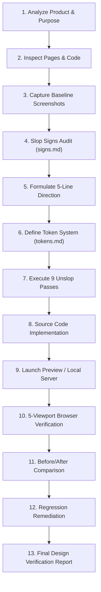

# 🔄 DESIGN_WORKFLOW.md: Automated Unslopping & Precision Design Workflow

**Workflow Name**: Antigravity Automated Unslopping & Frontend Engineering Protocol  
**Operational Foundation**: Unslop 9-Pass Redline Review + Impeccable Craft Protocol  
**Standard Viewports**: 320px, 375px, 768px, 1024px, 1440px  

---

## 1. The 13-Stage Execution Lifecycle

This operational workflow must be executed whenever reviewing, polishing, or refactoring frontend interfaces in Google Antigravity.

---

## 2. Step-by-Step Operational Instructions

### Stage 1: Analyze Application & Purpose
- Understand the product's domain, target persona, and core value proposition.
- Determine whether it is a dense B2B SaaS dashboard, candidate career hub, developer console, or public marketing landing page.

### Stage 2: Inspect Existing Pages & Components
- Traverse source code (`src/pages/`, `src/components/`).
- Inspect CSS architecture, framework version (e.g. Tailwind v4 `@theme`), font imports, and icon dependencies.

### Stage 3: Capture Baseline Screenshots
- Using Playwright MCP (`browser_navigate`, `browser_resize`, `browser_take_screenshot`) or `node scripts/snapshot.mjs <url> <out.html>`, capture baseline screenshots at 1440px and 375px.

### Stage 4: Slop Signs Audit (`references/signs.md`)
- Review against the slop signs taxonomy:
  - Surfaces: Hue gradients, colored glows, glassmorphism.
  - Type: 800/900 bold headings, uppercase tracked labels, mixed number formatting.
  - Icons: Emoji icons, inconsistent icon strokes.
  - Copy: "Welcome back!", exclamation marks, buzzwords ("supercharge", "seamless").
  - Components: Glowing pills, equal width cards, fake sparklines.
  - Visuals: 3D glossy blobs, metallic orbs, abstract AI waves.

### Stage 5: Formulate the 5-Line Direction
Write 5 concrete lines derived from the product:
1. **Product**: Plain one-sentence description of what it does and for whom.
2. **Character**: 2–3 concrete adjectives (e.g., `calm, exact, technical` or `editorial, warm, human`). Never generic words like "modern" or "clean".
3. **World**: Natural environment of the product (e.g., `monitoring console, night shifts, instruments` or `paper, ink, editorial`).
4. **Moments**: 1 or 2 specific elements that carry color and craft (e.g., a high-density telemetry chart, a tangible transaction card).
5. **Signature**: One small unique product detail (e.g., a pulsating status dot, live terminal keycaps).

### Stage 6: Define Token System (`references/tokens.md`)
- Select the neutral ramp: **Graphite**, **Warm**, or **Ink**.
- Define the accent color with confirmed 4.5:1 contrast against both light and dark backgrounds.
- Select the typography pairing (Interface family + optional partner Mono/Serif).

### Stage 7: Execute the Nine Unslop Passes
Apply changes layer by layer:
- **Pass 1 — Spacing**: 4px rhythm, group containment, row heights (32–44px).
- **Pass 2 — Color**: Neutral surfaces, 3 text roles, single accent, 4.5:1 contrast.
- **Pass 3 — Icons**: Lucide 16/18px line set, stroke 1.5, matching text color.
- **Pass 4 — Copy**: Domain facts, no greetings, no exclamation marks, no hype adjectives.
- **Pass 5 — Type**: 400/500 weights, sentence case, tabular numerals.
- **Pass 6 — Layout**: Desktop proportions (1440–1600 capped), calm headline space, 1 primary action.
- **Pass 7 — Details**: Concentric radius math, quiet badges, keycaps.
- **Pass 8 — Visuals**: Real product preview in code, tangible domain moments.
- **Pass 9 — Motion**: Purposeful ease-out transitions on transform/opacity only.

### Stage 8: Source Code Implementation
- Edit source code files directly.
- Maintain documentation integrity and preserve working business logic and state management.

### Stage 9: Launch Application & Verification Server
- Execute production build (`npm run build`).
- Verify zero TypeScript compiler errors (`tsc -b`).
- Ensure local preview server is active on `http://localhost:4173/` or dev server on `http://localhost:5173/`.

### Stage 10: 5-Viewport Browser Verification
- Using Playwright MCP, inspect and take screenshots across:
  - **320px** (Compact mobile)
  - **375px** (Standard mobile)
  - **768px** (Tablet portrait)
  - **1024px** (Tablet landscape)
  - **1440px** (Desktop telemetry)

### Stage 11: Before & After Comparison
- Compare newly rendered screens against baseline captures.
- Verify that every item on the slop audit list has been eradicated.

### Stage 12: Regression Remediation
- Confirm zero horizontal overflow (`scrollWidth === clientWidth`).
- Verify keyboard focus states (`:focus-visible` ring).
- Verify interactive states (hover, active, dropdowns, modals).

### Stage 13: Final Design Verification Report
- Produce a structured markdown report documenting the direction, passes applied, verification evidence, and release readiness.

