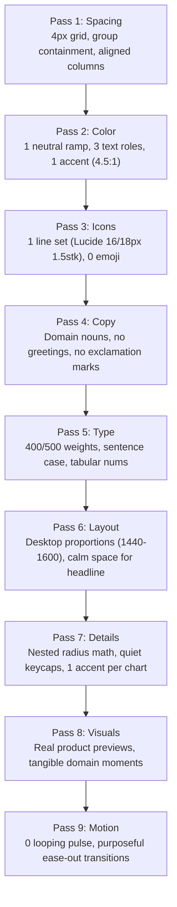

# 🏛️ FRONTEND_DESIGN_CONSTITUTION.md: Sovereign Frontend Design & Anti-Slop Constitution

**Authority**: Principal UI/UX Architect & Frontend Design Engineering Lead  
**Governing Standard**: Human-Crafted Product Design, Unslop Protocol & Impeccable Precision Craft  
**Enforcement Level**: **MANDATORY FOR ALL CODE AND UI GENERATION**  

---

## 1. Prime Mission & Core Philosophy

Every digital product developed in Google Antigravity must feel intentionally designed and engineered by experienced human product designers—never like an automated AI template.

```
PRODUCT UNDERSTANDING BEFORE DESIGN.
DESIGN SYSTEM BEFORE COMPONENT STYLING.
COMPOSITION BEFORE DECORATION.
REAL ASSETS BEFORE PLACEHOLDERS.
FUNCTIONALITY BEFORE VISUAL CLAIMS.
BROWSER VERIFICATION BEFORE COMPLETION.
```

The difference between slop and craft is **where the richness goes**:
- **Slop** spreads color, gradients, and glowing effects over the chrome (backgrounds, buttons, borders, labels).
- **Craft** keeps the chrome quiet, restrained, and functional, placing richness strictly into one or two memorable moments of real product content (a rendered object, a precise chart, a domain visual).

---

## 2. Absolute Negative Constraints (Banned Patterns)

Any implementation containing the following patterns **strictly fails quality gates**:

### A. Surfaces & Color
- ❌ **No Purple/Violet Radial Glows**: Banned `#8B5CF6`, `#A855F7`, or multi-hue mesh gradients on backgrounds or cards.
- ❌ **No Gradient Text**: Solid high-contrast text only.
- ❌ **No Colored Glows / Shadows**: Banned `shadow-[0_0_20px_rgba(139,92,246,0.5)]` or neon colored borders.
- ❌ **No Excessive Glassmorphism**: Eliminate unmotivated `backdrop-blur` with semi-transparent borders on every card. Use crisp 1px hairline borders (`rgba(255,255,255,0.08)` or `border-slate-200/90`).
- ❌ **No Multi-Hue Cards**: Keep all surfaces inside a single neutral ramp.

### B. Typography & Copywriting
- ❌ **No Ultra-Bold Headings**: Avoid weights 800 or 900. Restrain typography to weights 400 and 500, with 600 reserved for rare emphasis.
- ❌ **No Uppercase Tracked Labels**: Convert `NAVIGATION` or `PAID THIS MONTH` to sentence case (`Navigation`, `Paid this month`).
- ❌ **No AI Hype Words**: Eliminate words like *"supercharge"*, *"seamless"*, *"unlock"*, *"magic"*, *"revolutionize"*, *"next-gen"*, *"delve"*, *"tapestry"*.
- ❌ **No Exclamation Marks**: No `!!` in UI copy or button labels.
- ❌ **No Greeting Headlines**: No `Welcome back, John! 👋`. Name the context (e.g. `October 2026`, `Overview`).
- ❌ **No Trailing Periods on Labels**: Buttons and labels end without periods.
- ❌ **No Plausibility Failures**: Never output `[X]`, `123,456`, or unverified claims like `Loved by 10,000+ teams`.

### C. Iconography & Visual Assets
- ❌ **No Emoji as UI Icons**: Banned 🏠, 🚀, 💰, ⚠️, 📈, 🔥, 🤖 as interface icons.
- ❌ **No Sparkles on AI Features**: Eliminate `✨` as a substitute for clear interface copy.
- ❌ **No 3D Glossy Blobs**: Banned floating metallic orbs, liquid chrome shapes, holographic brains, or abstract geometric clutter.
- ❌ **No Invented Logos**: Never invent an enterprise brand logo. Use verified SVG assets from official repositories.

### D. Motion
- ❌ **No Looping Pulse on Static Elements**: Eliminate `animate-pulse` or `animate-ping` unless representing an active live socket or stream.
- ❌ **No `transition-all`**: Transition explicit properties only (`transition-colors`, `transition-[transform,opacity]`).
- ❌ **No Hover Scaling on Cards**: Banned `hover:scale-105` on large content cards.

---

## 3. Systematic Design Tokens & Spatial Geometry

### A. The 4px Spatial Grid
All margins, paddings, gaps, and fixed heights must be multiples of 4:
`4, 8, 12, 16, 20, 24, 32, 40, 48, 64, 80, 96, 128`
- **Inside controls**: 4px to 12px
- **Between list rows**: 2px to 8px
- **Between groups**: 12px to 24px
- **Between major sections**: 32px to 64px (landing page sections: 80px to 128px)
- **Standard row heights**: 32px (compact), 36px (default), 40px–44px (touch target)

### B. Neutral Ramps
Choose a single neutral ramp tinted toward the product's world:
- **Graphite**: Precise, technical, architectural (`#141415` dark / `#fafafa` light)
- **Warm**: Human, editorial, paper, crafted (`#161513` dark / `#f7f4ee` light)
- **Ink**: Deep night, telemetry, oceanic (`#0b0d14` dark / `#f5f7fa` light)

### C. Concentric Radius Geometry
Nested containers must satisfy the concentric radius formula:
$$R_{\text{inner}} = \max(0, R_{\text{outer}} - \text{Padding})$$
*Example: Outer panel $R=16\text{px}$ with $8\text{px}$ padding contains children with $R=8\text{px}$.*

---

## 4. The 9-Pass Unslop Execution Protocol

When developing or refactoring any interface, execute the nine passes in strict sequence:



---

## 5. Five-Point Responsive Verification Protocol

Every page and component must be visually verified in real rendered viewports:
1. **320px** — Minimal mobile (Galaxy Fold / Small devices)
2. **375px** — Standard mobile (iPhone SE / iPhone 13/14)
3. **768px** — Tablet portrait (iPad Mini / Air)
4. **1024px** — Tablet landscape / Compact laptop
5. **1440px** — Large desktop telemetry monitor

No code changes are complete without concrete evidence of successful execution.

