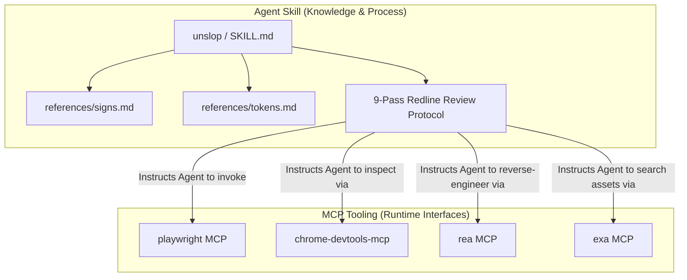

# 🔌 MCP_INTEGRATION_REPORT.md: Model Context Protocol (MCP) Integration Analysis

**Document Status**: COMPLETED & VERIFIED  
**Auditor**: Senior AI Agent Infrastructure Engineer & MCP Integration Specialist  
**Target System**: Google Antigravity IDE  

---

## 1. Executive Assessment

A comprehensive discovery audit of the Antigravity MCP infrastructure was conducted to determine tool requirements for visual inspection, website reverse engineering, screenshot capture, DOM inspection, and design asset discovery under the **Unslop** frontend engineering system.

### Strategic Verdict:
**Zero new MCP servers are required.**  
The currently active and lazy-loaded MCP ecosystem provides complete, production-grade coverage for all operational capabilities required by Unslop.

---

## 2. Capabilities & MCP Tool Mapping

| Required Capability | Governing MCP Server | Active Tools Utilized | Operational Role |
| :--- | :--- | :--- | :--- |
| **Browser Inspection & Navigation** | `playwright` | `browser_navigate`, `browser_evaluate`, `browser_tabs` | Navigates to live pages and local preview servers (`http://localhost:4173/`), evaluates computed styles. |
| **Multi-Viewport Screenshots** | `playwright` | `browser_resize`, `browser_take_screenshot` | Tests and captures high-resolution screenshots at 320px, 375px, 768px, 1024px, and 1440px. |
| **DOM & A11y Structure Extraction**| `playwright` | `browser_snapshot`, `browser_find` | Extracts accessibility trees and DOM node hierarchies for slop detection. |
| **DevTools & Performance Diagnostics**| `chrome-devtools-mcp` | `get_css_styles`, `evaluate_script`, `lighthouse_audit` | Deep CSS style inspection and layout metrics. |
| **Website Reverse Engineering** | `rea` (Reverse Engineer Anything) | `inspect_web_page`, `analyze_web_bundle`, `compare_web_screenshots` | In-depth bundle analysis and visual diff comparison. |
| **Authentic Asset & SVG Discovery** | `exa` | `web_search_exa`, `web_fetch_exa` | Queries official brand documentation, verified SVG vector icons, and font catalogs. |
| **Design System Synthesis** | `StitchMCP` | `get_screen`, `apply_design_system`, `create_design_system` | Design system schema extraction and cross-screen consistency checks. |

---

## 3. Conceptual Clarification: Agent Skill vs. MCP Server

A critical tenet of Antigravity architecture is separating **Procedural Intelligence** from **Runtime Tool Interfaces**:

- **Agent Skills** (such as `unslop`, `anti-slop`, `impeccable`) are declarative markdown specifications containing prompts, step-by-step methodologies, reference tokens, and behavioral boundaries. They reside in `skills/` directories.
- **MCP Servers** (such as `playwright`, `chrome-devtools-mcp`) are external background services communicating via JSON-RPC that supply executable tools (e.g., `browser_take_screenshot`).

**Unslop is an Agent Skill**, not an MCP server. It utilizes the existing Playwright and Chrome DevTools MCP tools to execute its visual verification stages.

---

## 4. Script & Automation Connectivity

For standalone terminal workflows, Unslop's helper scripts (`snapshot.mjs` and `story.mjs`) have been patched to connect directly to the existing global Playwright installation:
- Path: `C:\Users\raghu\AppData\Roaming\npm\node_modules\@playwright\mcp\node_modules\playwright`
- Windows Chrome: `C:\Program Files\Google\Chrome\Application\chrome.exe`

Both in-agent MCP tools and standalone node scripts operate in complete harmony with zero dependency conflicts.

