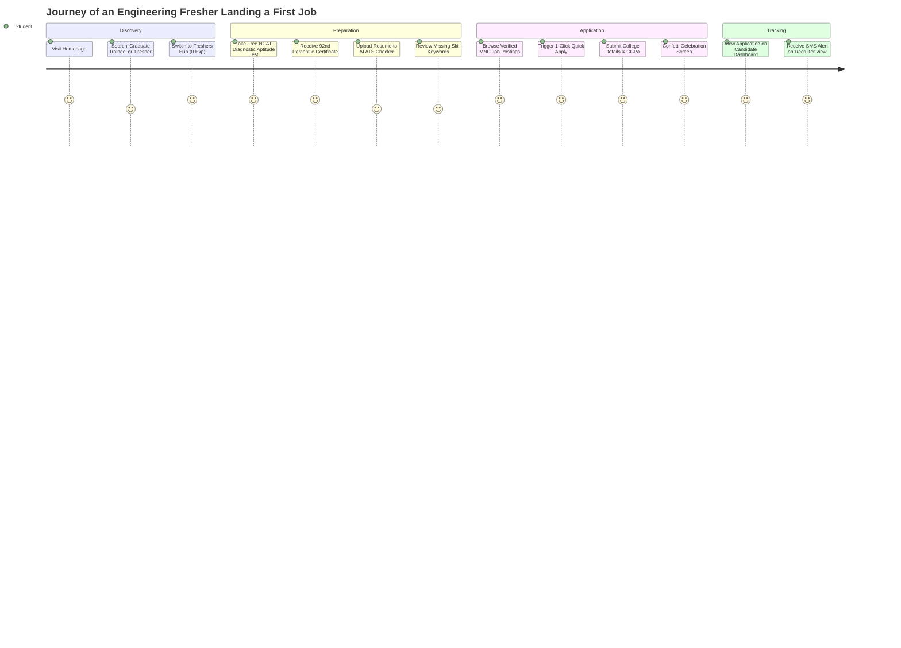
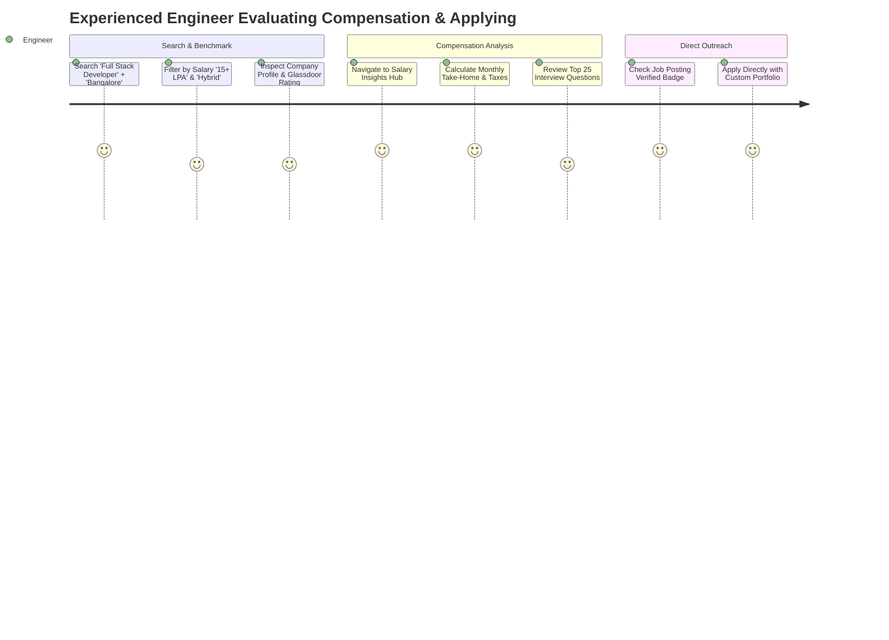
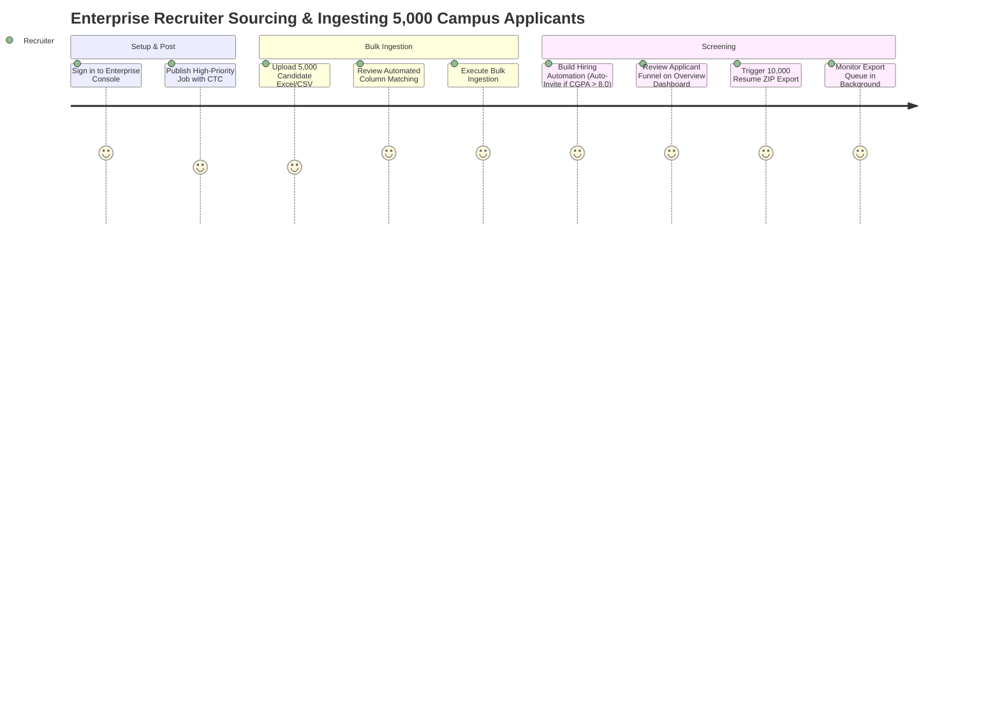
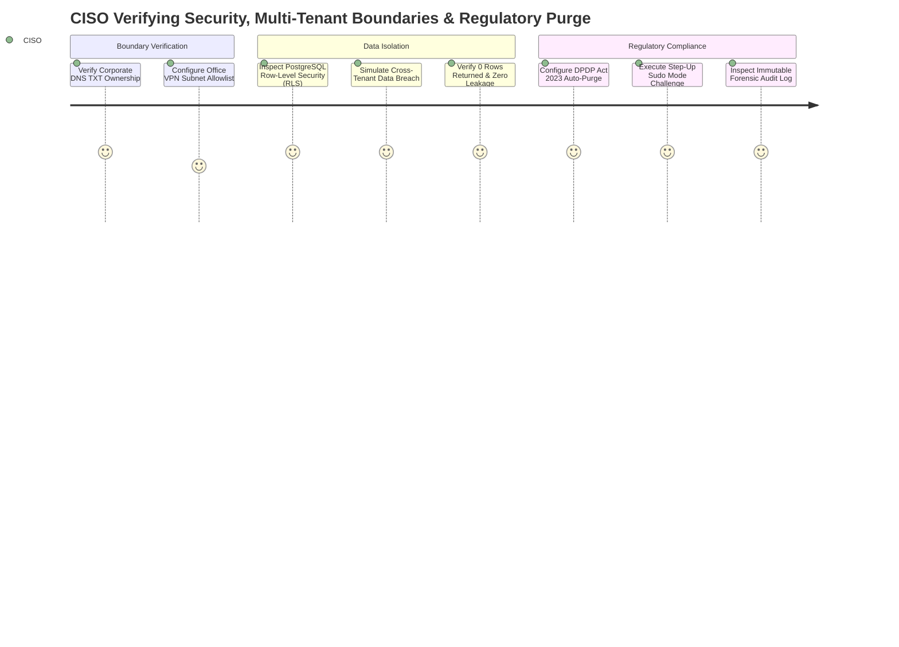
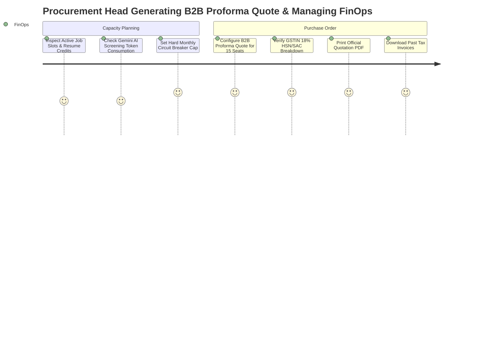

# 🗺️ USER_JOURNEY_MAP.md: End-to-End Persona Experience Flows

**Repository**: `D:\PROJECTS\New folder\career-connect-pro`  
**Core Personas**:
1. College Fresher (2025/2026 Batch)
2. Experienced Software Engineer (2–6 Yrs Exp)
3. Enterprise Talent Acquisition Lead / HR Recruiter
4. Chief Information Security Officer (CISO) & IT Admin
5. Finance & Billing Administrator (FinOps)

---

## Journey 1: College Fresher / Engineering Student

### Critical Touchpoints:
- `HomePage.tsx` -> `JobListingsPage.tsx?specialFilter=freshers`
- `CampusPage.tsx` (NCAT Timed Diagnostic Tab)
- `ResumeBuilderPage.tsx` (AI ATS Score & Keyword Analysis)
- `QuickApplyModal.tsx` -> `DashboardPage.tsx` (Status Pipeline)

---

## Journey 2: Experienced Tech Professional

### Critical Touchpoints:
- `SearchBar.tsx` -> `JobListingsPage.tsx` (Faceted dynamic counts)
- `CompanyDetailPage.tsx` (AmbitionBox reviews & benefits)
- `SalariesPage.tsx` (CTC Take-Home calculator)
- `InterviewPrepPage.tsx` (2,500+ Verified Q&A bank)

---

## Journey 3: Enterprise Talent Acquisition Lead

### Critical Touchpoints:
- `EmployersPage.tsx` -> `PostJobPage.tsx`
- `AppLayout.tsx` -> `CandidateCsvImportPage.tsx`
- `HiringWorkflowBuilderPage.tsx` (If-This-Then-That rules)
- `ExportQueuePage.tsx` (Background task manager)

---

## Journey 4: CISO & IT Governance Lead

### Critical Touchpoints:
- `DomainVerificationPage.tsx` (@company.com DNS TXT)
- `IpAllowlistPage.tsx` (CIDR geofencing)
- `RowLevelSecurityPage.tsx` (Postgres 16 RLS simulation)
- `DataRetentionPage.tsx` & `AuditLogsPage.tsx` (Forensic trail)

---

## Journey 5: Finance & Procurement Administrator

### Critical Touchpoints:
- `UsageDashboardPage.tsx` (Active slots meter)
- `AiCreditsPage.tsx` (Budget cap & consumption)
- `ProformaQuotePage.tsx` (Printable GST quote PDF)
- `InvoicesPage.tsx` (Past receipts archive)

